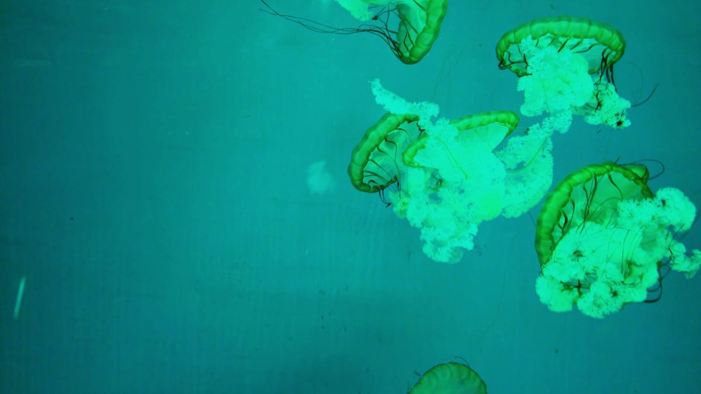
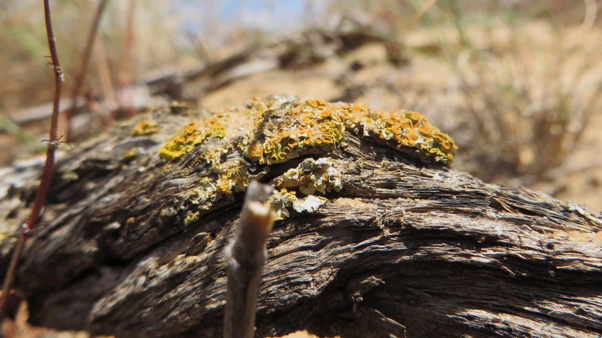
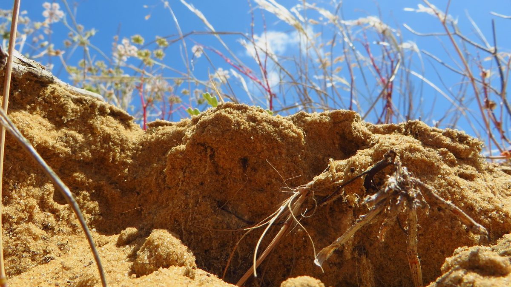
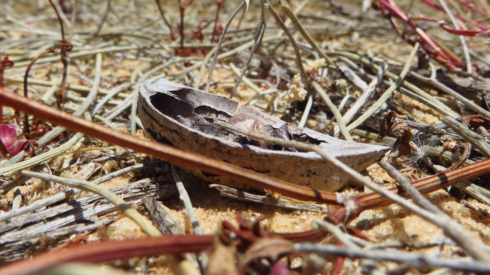
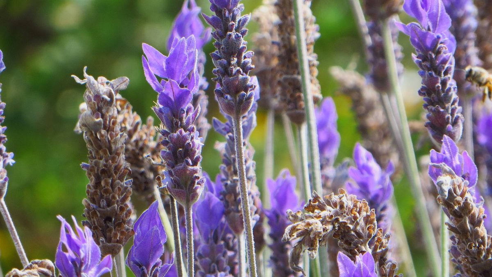
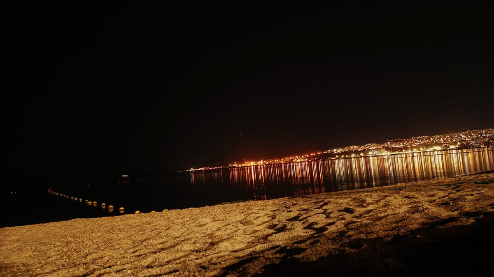
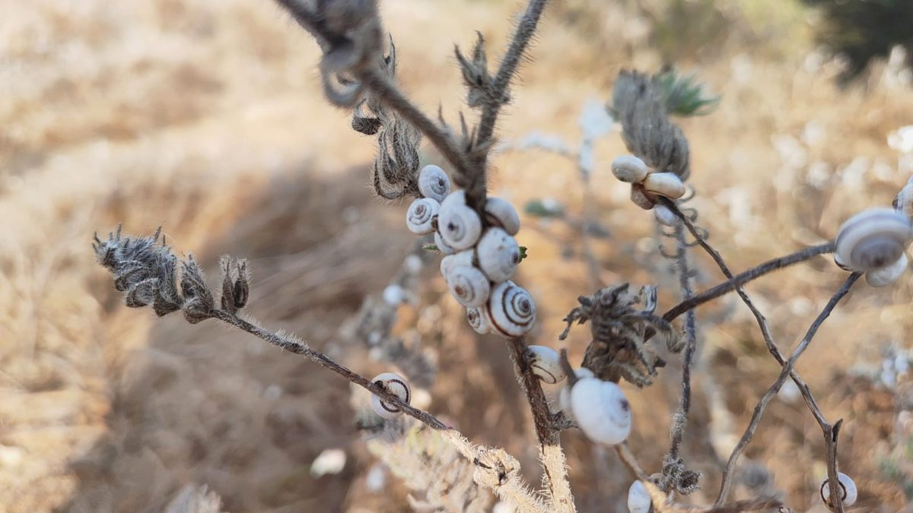
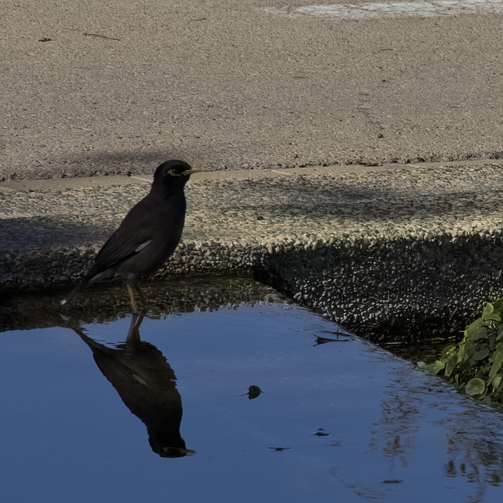

# web-under-4mp

8 photos by Yuval Kolodkin-Gal.

### Jellyfish Drift

Phone camera · 2024-03-15 · sea-life · original 2.3 MP

### Golden Lichen

Canon PowerShot SX270 HS · 2025-04-26 · nature-details · original 1.4 MP

### Sand and Sky

Canon PowerShot SX270 HS · 2025-04-26 · landscape · original 1.4 MP

### Seedpod Still Life

Canon PowerShot SX270 HS · 2025-04-26 · nature-details · original 1.4 MP

### Lavender Light

Canon PowerShot SX270 HS · 2025-05-03 · flowers-plants · original 1.4 MP

### Night Shore

Phone camera · 2026-02-26 · night · original 3.1 MP

### Summer Spirals

Phone camera · 2026-08-14 · insects · original 1.9 MP

### Birds 0298

Canon EOS R50 · 2026-11-13 · birds · original 3.8 MP
